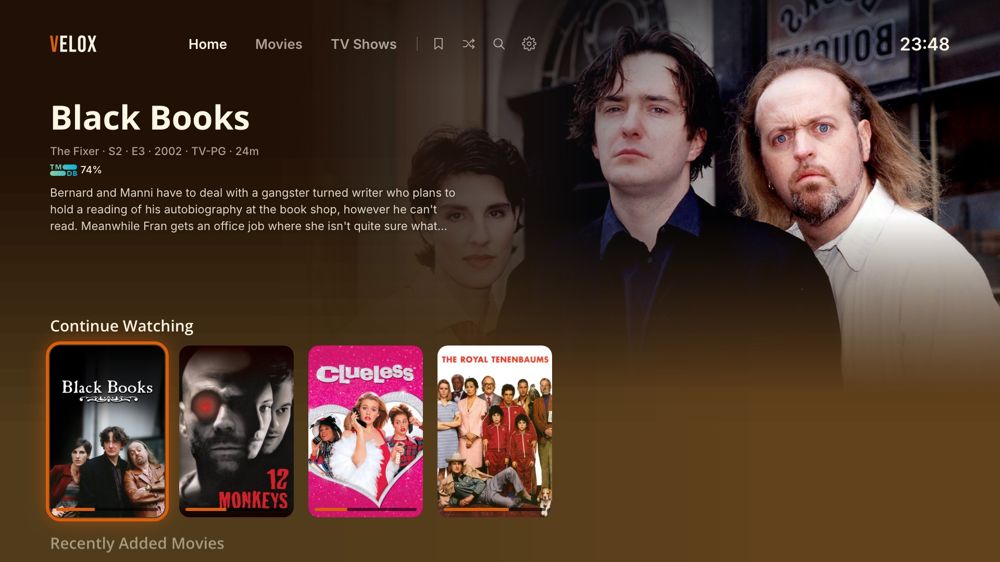
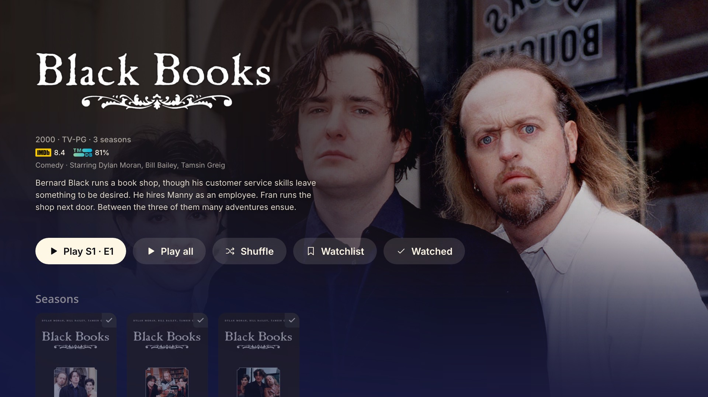
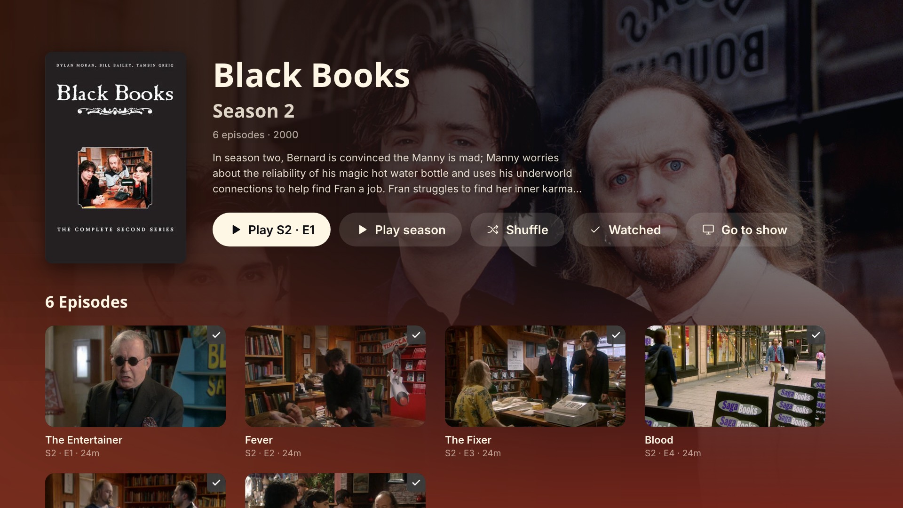
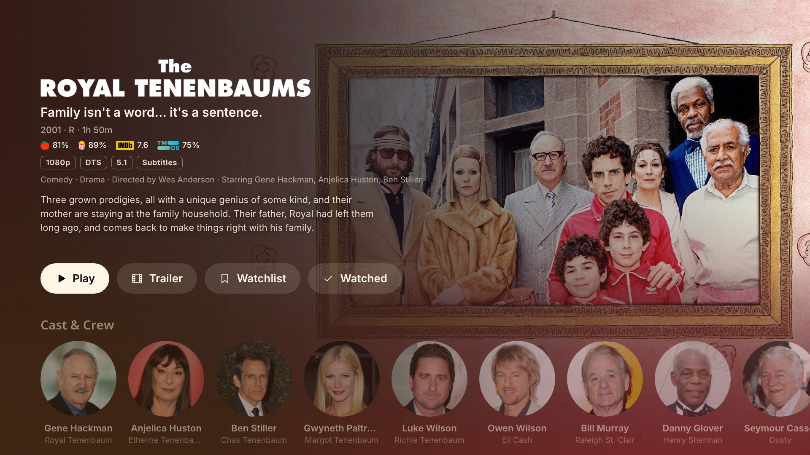

<p align="center">
  
</p>

<h1 align="center">Velox</h1>

<p align="center">
  <b>A fast Plex client for Samsung Tizen TVs, including Tizen 6.0.</b><br>
  Smooth scrolling, hardware playback, no framework.
</p>

Velox is a from-scratch Plex client for Samsung TVs, built on
[SamSUCKS](https://github.com/rfaile313/samsucks) by rfaile313. It keeps SamSUCKS's
speed (the official Plex app takes about a minute to open on these TVs; this takes
about a second) and adds Tizen 6.0 support plus most of what people miss from the
official app.

<p align="center">
  
</p>

<table>
  <tr>
    <td></td>
    <td></td>
    <td></td>
  </tr>
</table>

<sub>Screenshots of the real app with a real Plex library.</sub>

## What it does

- **Home, libraries and search** with poster rows and grids, a clock in the top bar,
  and auto-fitting titles.
- **Stays fresh:** new media shows up in Home and the library grids without restarting
  the app (it checks every couple of minutes while you're on them, and when the TV wakes;
  adjustable in Settings).
- **Genres** for each library: a tile per genre with artwork, opening the library
  filtered to it.
- **Collections, an unwatched filter and Shuffle** in libraries, and a Shuffle button
  on the home screen that plays unwatched movies back to back (or all movies, or random
  episodes mixed from shows you tick in Settings).
- **Theme music:** a show's theme tune plays quietly on its show, season and episode
  pages (Settings can turn it off).
- **Season pages** like the official app: poster, Resume / Play season / Shuffle /
  Watched, and the season's episodes in a grid.
- **Play all and Shuffle** for a show (on its page) or a season.
- **Detail pages** with Rotten Tomatoes, IMDb and TMDB ratings, media flags (4K, HDR10 /
  Dolby Vision, Atmos, DTS, 5.1, subtitles), a cast & crew row, a Trailer button and the
  full synopsis.
- **Actor pages** with photo, bio, what of theirs is in your library, and their full
  filmography (from Plex Discover).
- **Playback** straight through Samsung's hardware decoder whenever the TV can decode
  the file; otherwise Plex converts only what it must (usually just DTS audio).
  - Skip intro / skip credits, using the server's detected markers. Credits can be
    skipped automatically, or ignored when the server's detection is unreliable.
  - Chapters: a strip of chapter thumbnails, marks on the seek bar, and CH ▲ / CH ▼
    to jump between them.
  - Jump back and forward (10 and 30 seconds by default, set in Settings), a Stop
    button, and accelerating seek on ◀ ▶.
  - Streaming quality: Original, or a bitrate cap from 20 Mbps down to 1 Mbps, which
    makes Plex convert bigger files. Auto plays the original on your network and caps it
    away from home (8 Mbps, or 2 Mbps through Plex's relay). Changeable per video too.
  - Audio and subtitle tracks, external `.srt` files, and **subtitle search and
    download** (OpenSubtitles, through your server).
  - Subtitle size, colour, font, weight, position, style (outline, drop shadow, box,
    light box or plain) and per-file sync.
  - Anamorphic video shown at its real aspect ratio.
  - Playback info: direct play or converted, codecs, resolution, bitrate, and what the
    server is doing while it converts (Options → Playback info).
  - Up next: a card with the next episode when the final credits start (if the server
    detected them) or when the episode ends, with autoplay after 5–30 seconds or off.
  - Still watching?: after hours of autoplay with no remote use (1–3, default 2), it asks
    before playing the next episode, like Plex's Passout Protection.
  - Resume, and watch progress synced back to Plex.
- **Home-bar tiles:** Continue Watching and Recently Added appear above the app in the
  TV's Smart Hub bar; choosing one plays or opens it.
- **Screensaver:** after a timeout you choose (30 seconds to an hour; Settings has a Preview), the Velox or DVD logo bounces around a black
  screen changing colour at each wall, your library's artwork plays as a slideshow, or
  one of the Windows classics: 3D Pipes, Starfield or Bezier curves.
- **Settings**, grouped into Account, Appearance, Home, Playback and Screensaver: accent colour, rounded or square posters, watched-badge style (Plex's corner box or rounded),
  home-bar tile style, screensaver, Velox logo on Home, startup animation, theme music, hide watched on Home,
  streaming quality, clock (24-hour, 12-hour or off), server and account.

## Install

You need:
- a Samsung TV from 2020 or newer (tested on a 2021 Frame, Tizen 6.0; the original
  project was tested on a 2022 Q60B, Tizen 6.5),
- a Mac or Linux computer on the same network, with `git`, `zip` and
  [Node.js](https://nodejs.org) 18 or newer,
- a Plex Media Server the TV can reach. If the TV and server are on different VLANs,
  allow the TV to reach the server on TCP 32400.

**1. Turn on Developer Mode on the TV**

1. Press **Home** and open **Apps**.
2. On the Apps screen, type **1 2 3 4 5** on the remote (use the **123** button for the
   on-screen keypad if your remote has no number keys).
3. Switch **Developer mode** to **On** and enter your computer's IP address. Only that
   computer can install apps, so if its IP changes, enter the new one here.
4. Restart the TV: hold the **Power** button until it turns off and back on.

**2. Get the Apps2Samsung CLI**

[Apps2Samsung](https://github.com/Apps2Samsung/Apps2Samsung) installs apps on Samsung
TVs and signs them for you. Download `apps2samsung-cli` for your computer from its
[releases page](https://github.com/Apps2Samsung/Apps2Samsung/releases) and unpack it. On
a Mac, unblock it once with `xattr -d com.apple.quarantine apps2samsung-cli`.

**3. Get the app**

Easiest: download `velox.wgt` from the
[latest release](https://github.com/SuperDOS/velox/releases/latest) and skip to
step 4. To build it yourself instead:

```sh
git clone https://github.com/SuperDOS/velox.git
cd velox
cp .env.example .env    # the build script reads it; nothing in it needs changing for this
./scripts/deploy.sh --bundle --build-only
(cd build/app && rm -f ../velox.wgt && zip -qr -X ../velox.wgt . -x '.*')
```

This makes `build/velox.wgt`. `--bundle` packs the app into one script with esbuild
(fetched by `npx` the first time). Tizen 6.0 needs it, since its browser won't load
JavaScript modules from an app's own files, and it works on newer TVs too.

**4. Install on the TV**

```sh
./apps2samsung-cli scan                                         # find the TV's IP
./apps2samsung-cli install velox.wgt --tv <tv-ip> --launch
```

(Use the paths to wherever `apps2samsung-cli` and `velox.wgt` are; a build of your
own is at `build/velox.wgt`.) On Tizen 7 and newer you're
asked to sign in with a Samsung account to sign the package.

**5. Sign in**

The app opens on the TV. Go to **[plex.tv/link](https://plex.tv/link)** and enter the
code it shows, or scan the QR code.

**Updating:** download the new release (or `git pull` and build), then step 4 again. Installing over the existing app keeps
your sign-in and settings, so don't uninstall first.

**Uninstalling:** `./apps2samsung-cli uninstall VeloxApp01.velox --tv <tv-ip>`

<details>
<summary><b>Installing with Samsung's Tizen Studio instead</b></summary>

As in the original project: run `./scripts/setup.sh` once. It installs Samsung's
command-line tools, finds your TV, creates a signing certificate and writes `.env`. After
that, `./scripts/deploy.sh --bundle` builds, signs, installs and launches the app in one
go.
</details>

## Using it

| Remote | What it does |
| --- | --- |
| Arrows / OK | Move around / select |
| ▲ from the top row of a library | Shuffle, Unwatched, Sort, Collections |
| Play/Pause | Play whatever is focused, or pause and resume |
| Hold OK on a tile | Item menu: resume or restart, mark watched or unwatched (also whole seasons and shows), rate, fix match, add to Watchlist, remove from Continue Watching |
| Back | Go back (while watching, the first press hides the controls) |
| ◀ ▶ while watching | Seek; hold to go faster |
| ▼ while watching | The control row: Stop, jump back, play/pause, jump forward, Chapters, Audio & Subtitles (including search), and Options (quality, subtitle look and sync) |
| CH ▲ / CH ▼ while watching | Next chapter / start of this chapter (press again for the one before) |
| OK during an intro | Skip intro |
| CH ▲ / CH ▼ | Jump by letter in a library |

## For developers

<details>
<summary><b>Dev loop: logs, remote control and benchmarks on the real TV</b></summary>

Chrome DevTools can't attach to a retail TV, so dev builds talk to a small server on
your computer instead. Put your computer's `host:port` in `.env` as `DEV_HOST`, then:

```sh
node tools/devserver.mjs                    # receives logs and perf samples (build/tv.log)
./scripts/deploy.sh --dev --bundle --build-only
(cd build/app && rm -f ../velox.wgt && zip -qr -X ../velox.wgt . -x '.*')
./apps2samsung-cli install build/velox.wgt --tv <tv-ip> --launch

curl 'localhost:8790/send?keys=down,right,right,enter'       # press buttons
tools/tveval.sh 'document.title'                              # run JS on the TV, print the result
tools/tveval.sh '__bench(["right","right","left","left"], 250)'   # frame stats while replaying keys
tools/scan-tracks.sh 30                                       # files with over 30 tracks (the TV lists 32 at most)
```

Dev builds also report errors that happen before the app's own logger loads (such as
a module failing to load), and show a performance overlay (Settings → Performance overlay).
Set `window.__ss.muteTimeline = true` with `tveval.sh` to test playback without touching
watch history.
</details>

<details>
<summary><b>How the code is laid out</b></summary>

```
app/            the whole TV app; deploy.sh copies it to build/app and packages it
  js/screens/   home, library, detail, person, player, search, settings, login
  js/ui/        rows, grids, tiles, ratings, theme, image loader, backdrop, perf overlay
  js/plex/      plex.tv sign-in, Plex Media Server API, Plex Discover (people)
  js/platform/  Tizen keys and device info, AVPlay / <video> player, home-bar tiles
  js/util/      preferences, formatting, streaming quality, storage
  service/      background service that hands the home-bar tiles to the TV
scripts/        setup.sh (Tizen Studio, optional) and deploy.sh (build, bundle, install)
tools/          dev server, TV eval, network remote
```

Plain JavaScript, no framework. Without `--bundle`, newer TVs (Chromium 85+) run the ES
modules directly with `<link rel="modulepreload">`.
</details>

<details>
<summary><b>Tizen and Plex notes</b></summary>

- Tizen 6.0 (Chromium 76) blocks `<script type="module">` from `file://`; Tizen 6.5
  allows it. Hence `--bundle`.
- No zoom-to-fill: AVPlay rejects a display rect larger than the screen, and its
  `setVideoRoi` crop isn't supported on this TV.
- No playback speed: AVPlay only does whole-number speeds (trick play), and the TV's
  `<video>` can't decode the AC3/EAC3 audio Plex sends it (it plays silent).
- AVPlay ignores the pixel aspect ratio of anamorphic files, so the app sizes the video
  rectangle itself.
- Trailers redirect to Plex's CDN, which AVPlay can't play, so they're streamed through
  the server.
- Plex Media Server 1.42 returns `400` for `start.m3u8` unless
  `/video/:/transcode/universal/decision` was called for the same session first.
- `X-Plex-Platform=Tizen` selects the server's profile for the official app, which
  rejects these transcode requests, so the app identifies itself as `Samsung`.
- Smart Hub Preview (the home-bar tiles) works for a sideloaded app. The background
  service in `app/service/` gets `webapis` as a global on Tizen 6.0; the
  `require('$WEBAPIS/webapis/webapis.js')` in Samsung's guide fails there.
- Samsung TVs from 2018 on can't decode DTS. Plex copies the video and converts only
  the audio, to AC3 5.1.
- The full-screen CSS gradient behind the UI took almost two seconds per repaint on the
  TV's CPU; it's a 2×2 WebGL texture stretched by the GPU instead. See the
  [SamSUCKS README](https://github.com/rfaile313/samsucks#why-its-fast) for that story and
  the other performance work this app inherits.
</details>

## Credits

Based on [SamSUCKS](https://github.com/rfaile313/samsucks) by rfaile313, itself inspired
by [plx-native](https://github.com/GLinnik21/plx-native). Headings use
[Open Sans](https://fonts.google.com/specimen/Open+Sans) and body text
[Inter](https://rsms.me/inter/) (SIL Open Font License). QR codes:
[qrcode-generator](https://github.com/kazuhikoarase/qrcode-generator) by Kazuhiko Arase
(MIT). Rating logos belong to Rotten Tomatoes, IMDb and TMDB; the DVD Video logo to
DVD Format/Logo Licensing Corporation; Plex and the Plex logo belong to Plex, Inc.

Velox is an independent project, not affiliated with Plex or Samsung.

## License

Copyright © 2026 rfaile313 (SamSUCKS) and Velox contributors. Released under the
[GNU General Public License v3.0](LICENSE): you can use, study, change and share it,
and anything you distribute that's built on it must stay open source under the same
license.
